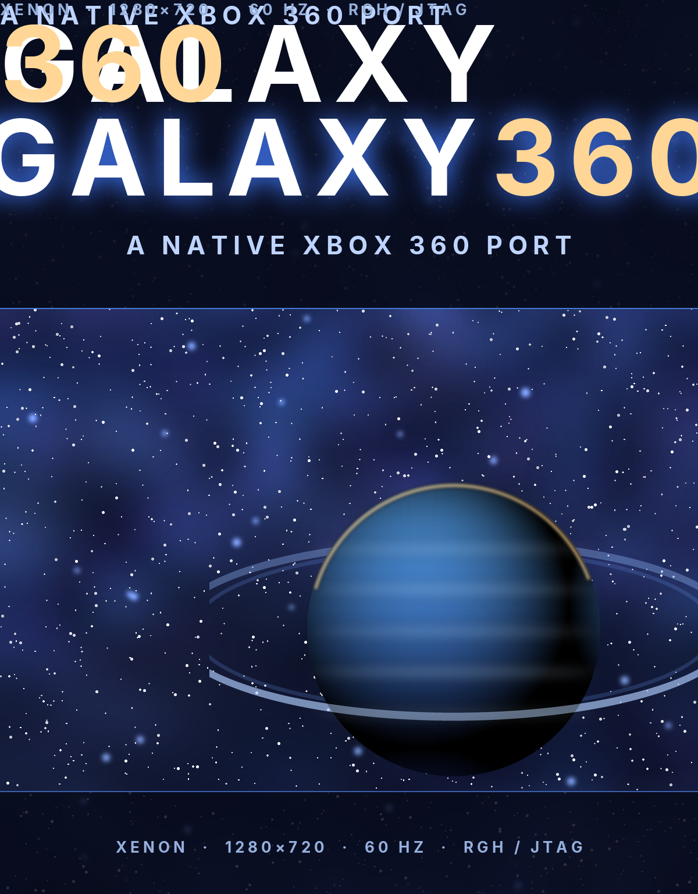

# galaxy-360 — Super Mario Galaxy, native on the Xbox 360

A native Xbox 360 port of *Super Mario Galaxy* on top of [Nebula](https://github.com/keepvaibin/nebula), the
decompilation of the game, through this project's Linux/desktop fork
[nebula-linux](https://github.com/fakerdoeslinux/nebula-linux). No emulator in the middle: the game's own code is
compiled for the console's Xenon CPU and draws through the Xenos GPU.

Built for a **modded console** (RGH or JTAG), 1280×720 at 60 Hz, with the console's 512 MB of memory split by the game's
own budgets instead of a PC's.



## Where this stands

Be straight about it: this is a port in progress, and the platform half is in.

| Piece | State |
|---|---|
| Platform layer (`platform/xbox360`) — boot, video mode, memory report, log, clock, thread pinning | **done** |
| Sound — XAudio2 device, 48 kHz stereo, float ring | **done** |
| Window — D3D9 device, 1280×720, 2× MSAA, predicated tiling, resolve, present, pad exit chord | **done** |
| Xenos device (`xenos_device.cpp`) — device, EDRAM tiles, resolve, texture creation and tiling swizzle | **done** |
| Runtime subset — mix, controls, saves, mods, settings model | **done** |
| D3D9/Xenos renderer core — the game's records to draw calls | **milestone 2** ([docs/RENDERER.md](docs/RENDERER.md)) |
| Game module (`smg_game`) for PowerPC | milestone 2 |
| Shader cooking (`programs.xsh`, SM 3.0) | milestone 2 |

Nothing in this tree was built or run on a console here: no 360 SDK and no modded hardware were available while it was
written. The platform layer links against the SDK's own PowerPC libraries; the numbers in `docs/PERFORMANCE.md` are the
console's documented budgets, not measurements from a run.

## Quick start (build box)

The build needs the **Xbox 360 SDK** (2.0.21256.3 or newer) on Windows. That is what the console's D3D9, XAudio2 and
XInput are; the free cross toolchains do not ship them.

```powershell
# 1. Get the tree this port patches
git clone https://github.com/keepvaibin/nebula nebula
cd nebula
git checkout 4f40d95
git apply ..\galaxy-360\patches\0001-linux-port.patch
git apply ..\galaxy-360\patches\0002-xbox360-platform.patch

# 2. Configure and build against the SDK
$env:XEDK = "C:\Xbox360\SDK"
cmake -S platform/xbox360 -B build/x360 `
      -DCMAKE_TOOLCHAIN_FILE=platform/xbox360/toolchain-xbox360.cmake `
      -DNEBULA_X360_RENDERER=ON
cmake --build build/x360 --config Release

# 3. Lay out the folder the console boots
python ..\galaxy-360\scripts\package.py --build build/x360 --out dist\galaxy-360
```

Or let the script do the three steps — patch, configure, build, package:

```powershell
powershell -ExecutionPolicy Bypass -File scripts\build-360.ps1 -Tree C:\src\nebula -Package
```

[docs/BUILD.md](docs/BUILD.md) has the toolchain install, the exact flags, and what each error means.

## Putting it on the console

Copy `dist/galaxy-360` to `Hdd:\Games\Galaxy360\` on the console (FTP with Aurora's or FSD's server, or a FAT32 USB
stick), copy `dist\galaxy-360\Hdd-Nebula` to `Hdd:\Nebula\`, then launch `default.xex`. The whole walk-through,
including cover art and the exit chord, is in [docs/RGH.md](docs/RGH.md).

## What the port does

- **The console, not a PC pretending.** `platform/xbox360` replaces the desktop's window, sound device and clock: the
  scaler's 1280×720@60 mode, XAudio2, Xenon's 50 MHz time base, and the memory the title may still take.
- **The frame fits the EDRAM.** 2× multisampled colour and depth do not fit the daughter die's 10 MB in one pass at
  720p, so the scene is drawn in predicated tiles and resolved into a texture the scaler reads.
- **Memory is budgeted at boot.** 192 MB of pak stream, 128 MB of textures, 48 MB of geometry, 36 MB of audio, 68 MB of
  game heap: pools sized once, never grown, because the console's allocator fragments under a long session.
- **The 512 MB is not a suggestion.** Textures are BC1/BC2/BC3 with the swizzle the driver wants, the shader cache is
  precompiled to `programs.xsh`, and audio is 48 kHz float straight into XAudio2.

## Layout

```
patches/0001-linux-port.patch      the shared desktop port (F10 menu, menu sounds, FPS counter)
patches/0002-xbox360-platform.patch  the console's platform layer
assets/                            cover, banner, icon — and the script that draws them
docs/                              build, port notes, performance budgets, RGH install, renderer plan
scripts/                           build (Windows/SDK) and package (anywhere)
tools/                             environment checks
```

## Credits and licence

The game's decompilation is [Nebula](https://github.com/keepvaibin/nebula); the desktop fork is
[nebula-linux](https://github.com/fakerdoeslinux/nebula-linux). This repository carries the console layer and the
project files around it, under the GPL-3.0 (see [LICENSE](LICENSE)).

*Super Mario Galaxy* is Nintendo's. This project ships no game data; you bring your own disc image, exactly as the
desktop port asks. The cover, banner and icon here are drawn by `assets/generate-art.py` — no Nintendo artwork is used.
